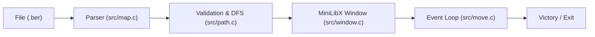
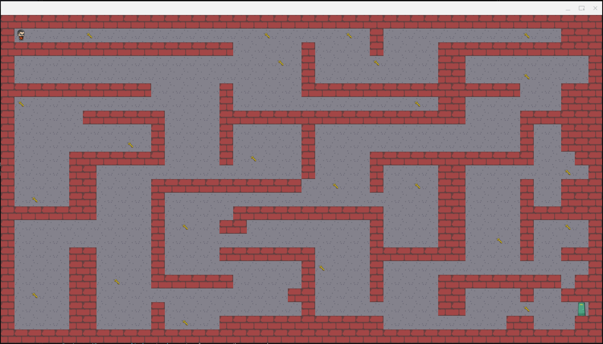
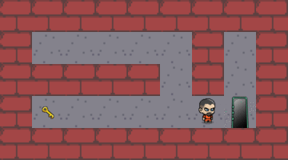
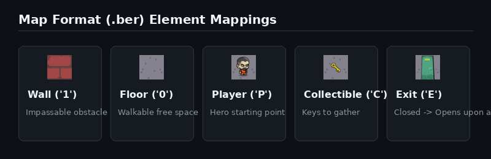
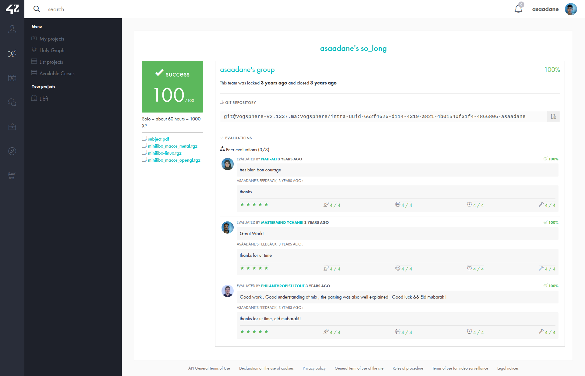

*This project has been created as part of the 42 curriculum by asaadane.*

# So_Long — 42 Cursus

A 2D retro dungeon crawler game engine written in C using MiniLibX, featuring strict map parsing, recursive depth-first search (DFS) path validation, and an optimized dirty-tile rendering pipeline.

<p align="center">
  
  
  
  
  
  
  
  
</p>

<p align="center">
  
</p>

---

## Project Information

| Item | Details |
|---|---|
| **Language** | C (C99 standard syntax) |
| **Compiler & Flags** | `cc` with `-Wall -Wextra -Werror -g` |
| **School** | 1337 Coding School (Khouribga) — 42 Network |
| **Target Output** | `so_long` (Executable Binary) |
| **Build System** | GNU Make (`cc`) |
| **Evaluation Score** | [100% (42 Peer Defense)](assets/validation/so_long-100.png) |
| **Graphics Framework** | MiniLibX (X11 on Linux / Cocoa & OpenGL on macOS) |
| **Unit Test Suite** | 57 Automated Assertions (`make test`) |
| **Campaign Levels** | 20 Progressive Levels (Tutorial → Master Screen Max) |
| **Documentation Hub** | [`docs/README.md`](docs/README.md) |
| **Author** | Ayman Saadane ([@Shifuuu31](https://github.com/Shifuuu31)) |

---

## Documentation

Explore the comprehensive documentation suite:

- **[Documentation Hub (docs/README.md)](docs/README.md)**: Central knowledge base, learning paths, and quick navigation.
- **[System Architecture (docs/ARCHITECTURE.md)](docs/ARCHITECTURE.md)**: Subsystem lifecycles, data structures, and pipeline diagrams.
- **[Game Mechanics (docs/GAME_MECHANICS.md)](docs/GAME_MECHANICS.md)**: Collision detection, coordinate tracking, sprite states, and victory rules.
- **[Map Format Specification (docs/MAP_FORMAT.md)](docs/MAP_FORMAT.md)**: `.ber` file syntax, geometric constraints, DFS flood-fill pathfinding, and diagnostics.
- **[Build & Usage Guide (docs/BUILD_AND_USAGE.md)](docs/BUILD_AND_USAGE.md)**: OS-specific prerequisites, compilation targets, and troubleshooting.
- **[Testing & Verification (docs/TESTING.md)](docs/TESTING.md)**: 57-assertion automated unit test suite (`make test`), 27-map verification matrix, and benchmarks.
- **[Project Technical Audit (docs/PROJECT_AUDIT.md)](docs/PROJECT_AUDIT.md)**: Full codebase audit, function inventory, and technical analysis.

### Quick Access

- [1. Introduction](#1-introduction)
- [2. Project Overview](#2-project-overview)
- [3. Objectives and Learning Outcomes](#3-objectives-and-learning-outcomes)
- [4. Game Architecture & Subsystems](#4-game-architecture--subsystems)
- [5. Game Mechanics & Gameplay Showcase](#5-game-mechanics--gameplay-showcase)
- [6. Controls](#6-controls)
- [7. Map Format Specification](#7-map-format-specification)
- [8. 20-Level Progressive Campaign](#8-20-level-progressive-campaign)
- [9. Installation & Prerequisites](#9-installation--prerequisites)
- [10. Compilation & Makefile](#10-compilation--makefile)
- [11. Usage Instructions](#11-usage-instructions)
- [12. Technical Concepts & Optimizations](#12-technical-concepts--optimizations)
- [13. Testing Instructions](#13-testing-instructions)
- [14. Validation Evidence](#14-validation-evidence)
- [15. Known Limitations](#15-known-limitations--technical-observations)
- [16. Resources & AI Usage](#16-resources--ai-usage)
- [17. Author & Credits](#17-author--credits)

---

## 1. Introduction

`So_Long` is an essential graphical milestone in the 42 coding school curriculum. It introduces software engineers to window management, low-level 2D rasterization, texture loading, event-driven programming, and algorithmic graph reachability.

The challenge requires creating a functional top-down 2D game using 42's internal graphical library, **MiniLibX**. The player controls a character who must navigate an enclosed dungeon, gather every collectible key, and safely escape through the exit portal in the fewest moves possible.

---

## 2. Project Overview

In graphical systems programming, balancing low-level memory safety with real-time event loops is paramount. `So_Long` implements:
- A custom map parsing pipeline enforcing strict geometric rectangularity and enclosing stone borders.
- A recursive **depth-first search (DFS) flood-fill algorithm** that validates that all keys and the exit are fully reachable before opening the display window.
- An optimized **dirty-tile rendering engine** that redraws only moving coordinates, avoiding full-window wipes and eliminating frame drops.
- A modular file structure separating source code ([`src/`](src)), header definitions ([`header/`](header)), test suites ([`tests/`](tests)), and documentation ([`docs/`](docs)).

---

## 3. Objectives and Learning Outcomes

- **Graphics & Window Management**: Interfacing with display servers via MiniLibX, creating native windows, and managing texture lifecycles.
- **Event-Driven Programming**: Hooking asynchronous keyboard inputs (`KeyPress`) and window events (`DestroyNotify`) without CPU-bound polling loops.
- **Graph Algorithms & Pathfinding**: Implementing recursive flood fill to assert reachability and prevent game deadlock.
- **Low-Level Memory Optimization**: Managing 2D matrices, heap allocations, and optimizing rendering draw calls.
- **Cross-Platform Engineering**: Supporting both Linux X11 systems and macOS Cocoa/OpenGL architectures transparently.

---

## 4. Game Architecture & Subsystems



The game is separated into cleanly decoupled layers:
- **`header/`**: Holds public interfaces (`so_long.h`, `libft.h`).
- **`src/`**: Houses the game engine implementation files (`main.c`, `map.c`, `move.c`, `path.c`, `tools.c`, `tools_2.c`, `window.c`) and utility routines (`src/libft/`).
- **`maps/`**: Contains standard `.ber` maps and the 20-level campaign.
- **`tests/`**: Contains an automated unit testing suite and regression maps.

---

## 5. Game Mechanics & Gameplay Showcase

<p align="center">
  
  <br>
  <em>The player traversing dungeon corridors, collecting keys, and approaching the exit portal.</em>
</p>

### Core Rules
- **Grid Plane**: Discrete 40 × 40 pixel tile system.
- **Orthogonal Movement**: Movement is strictly 4-directional (`Up`, `Down`, `Left`, `Right`).
- **Solid Obstacles**: Stone walls (`1`) block character advancement.
- **Collectibles**: Gathering a key (`C`) decrements the remaining counter and clears the tile.
- **Dynamic Exit State**: The exit portal (`E`) is locked and impassable while keys remain. The instant the last key is retrieved, the exit sprite dynamically transforms into an open gateway (`open_door.xpm`).
- **Victory Condition**: Stepping onto the open exit door prints `"You Win !!"` in green and cleanly terminates the process.

<p align="center">
  
  <br>
  <em>Once all keys are collected, the door opens, allowing the player to escape.</em>
</p>

---

## 6. Controls

`So_Long` natively supports both Linux X11 keysyms and macOS keycodes:

| Action | Primary Keys | Arrow Keys |
| :--- | :---: | :---: |
| **Move Up** | <kbd>W</kbd> | <kbd>▲</kbd> |
| **Move Down** | <kbd>S</kbd> | <kbd>▼</kbd> |
| **Move Left** | <kbd>A</kbd> | <kbd>◄</kbd> |
| **Move Right** | <kbd>D</kbd> | <kbd>►</kbd> |
| **Quit Game** | <kbd>ESC</kbd> | Window Close Button (<kbd>✕</kbd>) |

---

## 7. Map Format Specification

Maps are stored in `.ber` files structured with 5 symbols:

<p align="center">
  
</p>

```text
11111111111111
10001000000101
10000110101C01
1P0000000000E1
11111111111111
```

- **`1`**: Wall (impassable perimeter and obstacles)
- **`0`**: Floor (walkable empty space)
- **`P`**: Player spawn position (exactly 1 required)
- **`C`**: Collectible key (at least 1 required)
- **`E`**: Exit portal (exactly 1 required)

### Validation Rules
1. **Rectangular**: Every row must be equal in length.
2. **Closed Boundaries**: The outer perimeter must be entirely solid walls (`1`).
3. **Reachability**: The player must have a valid path to all collectibles and the exit without passing through the exit before collecting all keys.

---

## 8. 20-Level Progressive Campaign

The repository includes a progressive 20-level campaign scaling from tutorial rooms to maximum screen labyrinths:

| Level | Name | Dimensions | Coins | Difficulty | File |
| :---: | :--- | :---: | :---: | :--- | :--- |
| **01** | *Tutorial: The First Step* | 9 × 5 | 2 | Very Easy | [maps/level_01.ber](maps/level_01.ber) |
| **02** | *Tutorial: The Fork* | 11 × 5 | 3 | Very Easy | [maps/level_02.ber](maps/level_02.ber) |
| **03** | *The Small Chamber* | 13 × 7 | 4 | Easy | [maps/level_03.ber](maps/level_03.ber) |
| **04** | *Winding Paths* | 15 × 7 | 5 | Easy | [maps/level_04.ber](maps/level_04.ber) |
| **05** | *The Vault* | 17 × 9 | 6 | Easy-Medium | [maps/level_05.ber](maps/level_05.ber) |
| **06** | *Crossroads* | 19 × 9 | 7 | Easy-Medium | [maps/level_06.ber](maps/level_06.ber) |
| **07** | *The Spiral Crypt* | 21 × 11 | 8 | Medium | [maps/level_07.ber](maps/level_07.ber) |
| **08** | *Twin Halls* | 23 × 11 | 10 | Medium | [maps/level_08.ber](maps/level_08.ber) |
| **09** | *Pillars of Mystery* | 25 × 13 | 11 | Medium | [maps/level_09.ber](maps/level_09.ber) |
| **10** | *The Catacombs* | 29 × 13 | 13 | Medium-Hard | [maps/level_10.ber](maps/level_10.ber) |
| **11** | *Caverns of Echoes* | 31 × 15 | 15 | Medium-Hard | [maps/level_11.ber](maps/level_11.ber) |
| **12** | *The Sunken Courtyard* | 35 × 15 | 17 | Hard | [maps/level_12.ber](maps/level_12.ber) |
| **13** | *Serpent's Lair* | 37 × 17 | 19 | Hard | [maps/level_13.ber](maps/level_13.ber) |
| **14** | *Shadow Citadel* | 41 × 17 | 21 | Hard | [maps/level_14.ber](maps/level_14.ber) |
| **15** | *Minotaur's Dungeon* | 43 × 19 | 23 | Hard | [maps/level_15.ber](maps/level_15.ber) |
| **16** | *The Forgotten Keep* | 47 × 21 | 25 | Very Hard | [maps/level_16.ber](maps/level_16.ber) |
| **17** | *Obsidian Fortress* | 49 × 23 | 27 | Very Hard | [maps/level_17.ber](maps/level_17.ber) |
| **18** | *Labyrinth of Sorrow* | 53 × 25 | 29 | Very Hard | [maps/level_18.ber](maps/level_18.ber) |
| **19** | *Titan's Domain* | 55 × 27 | 32 | Extreme | [maps/level_19.ber](maps/level_19.ber) |
| **20** | *The Grand Abyss* | **59 × 31** | **35** | **Master (Max Screen)** | [maps/level_20.ber](maps/level_20.ber) |

---

## 9. Installation & Prerequisites

### Linux (Debian / Ubuntu / Kali / Pop!_OS)
```bash
sudo apt-get update
sudo apt-get install -y gcc make libx11-dev libxext-dev libbsd-dev
```

### macOS
Install the Xcode Command Line Tools:
```bash
xcode-select --install
```

---

## 10. Compilation & Makefile

Compile the game using the cross-platform Makefile:
```bash
make
```

### Makefile Rules
- `make` / `make all`: Compiles the executable `so_long`.
- `make test`: Builds and executes the automated 57-assertion C unit test suite.
- `make clean`: Removes compiled object files (`src/*.o`, `src/libft/*.o`).
- `make fclean`: Removes object files, the test binary, and the `so_long` executable.
- `make re`: Re-executes `fclean` followed by `all` for a clean rebuild.

---

## 11. Usage Instructions

Launch the game with any map file:

```bash
# Run classic standard map
./so_long maps/map.ber

# Run campaign levels
./so_long maps/level_01.ber
./so_long maps/level_07.ber
./so_long maps/level_20.ber
```

---

## 12. Technical Concepts & Optimizations

### 12.1 Dirty-Tile Rendering Optimization
Previously, `move_player()` cleared the window with `mlx_clear_window()` and redrew all 1,829 tiles on a 59 × 31 map. This saturated the X11 socket with nearly 2,000 draw calls per keystroke, causing visual tearing.

The engine was upgraded to **selective dirty-tile updating**:
1. Redraw previous position as floor (`'0'`).
2. Draw new position as player (`'P'`).
3. Update exit door to `open_door.xpm` once all keys are collected.

**Result**: Draw calls dropped from **1,829 to 2 per move** (**99.89% reduction**), yielding 60+ FPS zero-latency input.

### 12.2 DFS Flood-Fill Path Validation
Before initializing graphical windows or allocating textures, `check_path()` runs a recursive depth-first search on a cloned grid (`sl->tmp_map`). It verifies that all keys and the exit can be reached legitimately. If any collectible is unreachable, the program exits cleanly with `Cannot find a valid path`.

---

## 13. Testing Instructions

The repository includes an automated zero-dependency C unit test suite:

```bash
make test
```

### Test Coverage (57 Assertions)
- **Libft Utilities**: `ft_strlen`, `ft_strdup`, `ft_strncmp`, `ft_substr`, `ft_strjoin`, `ft_split`.
- **Tools & Extension Validation**: `.ber` extensions, character comparisons, element counters.
- **Invalid Map Edge Cases**: Missing files, empty files, non-rectangular grids, missing perimeter walls, missing/multiple players and exits, unreachable keys, unreachable exits.
- **Valid Map Regressions**: Minimal, corridor, multi-coin, and campaign levels.
- **Movement & Collision Logic**: Wall collision, movement counter increments, key decrement, and exit unlocking.

---

## 14. Validation Evidence

The project received a **100% score** during its 42 peer defense evaluation:

<p align="center">
  
</p>

---

## 15. Known Limitations & Technical Observations

1. **Fixed Window Resolution**: Windows use fixed geometry matching `width * 40` and `height * 40`. Maps larger than the host display resolution will exceed screen boundaries.
2. **Byte-by-Byte Ingestion**: `load_map()` reads byte-by-byte with `read(fd, buffer, 1)` and `ft_strjoin`. While reliable and simple, buffered block reads (e.g., 4096 bytes) would improve I/O efficiency on massive files.

---

## 16. Resources & AI Usage

### References
- [MiniLibX Documentation](https://harm-smits.github.io/42docs/libs/minilibx): Reference for window creation, image manipulation, and event loops.
- [X11 Protocol Specification](https://www.x.org/releases/X11R7.7/doc/xproto/x11protocol.html): Window attributes and event masks.
- [Itch.io Game Assets](https://itch.io/game-assets): Retro pixel art tilesets.

### AI Usage Disclosure
In compliance with **42 Subject v5.0 Chapter IV & VI (AI Instructions)**:
- AI was used for restructuring documentation, drafting system architecture diagrams, analyzing cross-platform keycodes, and generating the progressive 20-level campaign maps.
- All code logic, memory boundaries, and verification suites were manually inspected, reviewed, and validated against the 42 subject rules.

---

## 17. Author & Credits

- **Ayman Saadane** — 42 Student & Software Developer
- **GitHub**: [@Shifuuu31](https://github.com/Shifuuu31)
- **Repository**: [So_Long_42-cursus](https://github.com/Shifuuu31/So_Long_42-cursus)
