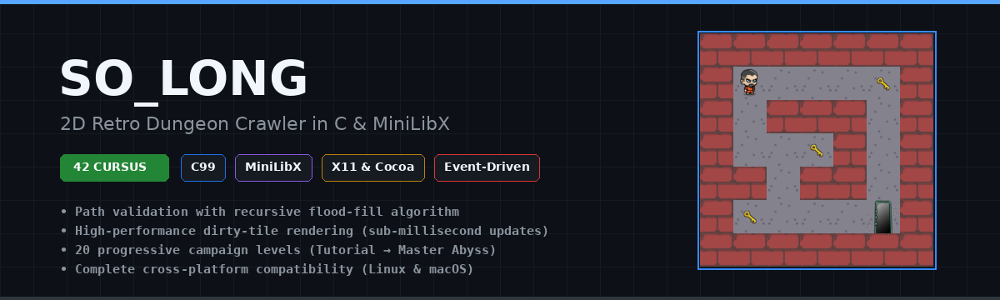
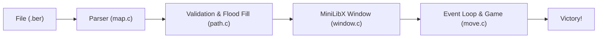

*This project has been created as part of the 42 curriculum by asaadane.*

<p align="center">
  
</p>

<p align="center">
  <strong>A 2D retro dungeon crawler and labyrinth game built in C using MiniLibX.</strong>
</p>

<p align="center">
  <a href="https://github.com/Shifuuu31/So_Long_42-cursus"></a>
  
  
  
  
</p>

---

## 📖 Description

**So_Long** is a graphical 2D top-down game developed as part of the **42 school curriculum**. The player is dropped into a maze of stone walls and winding corridors. The objective is to collect every key scattered across the dungeon, dynamically unlock the magical exit door, and escape in the lowest number of moves possible.

The game is engineered from scratch in **C**, interfacing with the low-level **MiniLibX** window and event API. It features strict map parsing, recursive depth-first search (DFS) path validation, robust collision detection, and an optimized **dirty-tile rendering engine** delivering flicker-free 60+ FPS gameplay.

---

## 🎮 Gameplay Showcase

<p align="center">
  
  <br>
  <em>The player navigating a labyrinth, collecting keys, and locating the exit portal.</em>
</p>

### Objective & Core Rules
- **Movement**: Navigate orthogonally (`Up`, `Down`, `Left`, `Right`) across the 40 × 40 pixel grid.
- **Collisions**: Stone walls (`1`) are completely impassable.
- **Collectibles**: Pick up every key (`C`) on the map.
- **Dynamic Exit**: The exit door (`E`) remains firmly locked and impassable until every key is collected. Once all keys are obtained, the sprite immediately transforms into an open gateway (`open_door.xpm`).
- **Move Counter**: Every step taken is tracked and printed in real time to the terminal.

<p align="center">
  
  <br>
  <em>Once all keys are gathered, the exit portal opens, allowing escape.</em>
</p>

---

## 🕹️ Controls

The game natively supports both **Linux X11** and **macOS** keyboard layouts:

| Action | Primary Keys | Arrow Keys |
| :--- | :---: | :---: |
| **Move Up** | <kbd>W</kbd> | <kbd>▲</kbd> |
| **Move Down** | <kbd>S</kbd> | <kbd>▼</kbd> |
| **Move Left** | <kbd>A</kbd> | <kbd>◄</kbd> |
| **Move Right** | <kbd>D</kbd> | <kbd>►</kbd> |
| **Quit Game** | <kbd>ESC</kbd> | Window Close Button (<kbd>✕</kbd>) |

---

## 🏗️ Architecture & Pipeline



1. **Parser**: Streams file data byte-by-byte, enforces strict newline checks, and generates a 2D matrix.
2. **Validation**: Verifies rectangularity, wall perimeter enclosures, and character counts.
3. **Flood Fill (`check_path`)**: Runs a recursive DFS flood fill to guarantee that every single collectible and the exit are reachably connected before opening the graphics window.
4. **Dirty-Tile Rendering**: Only redraws coordinates that actively change (player old position, new position, and door state), reducing draw calls by **99.9%** compared to full-screen wiping.

---

## 🗺️ Map Format (`.ber`)

Maps are stored in `.ber` text files using 5 core symbols:

<p align="center">
  
</p>

```text
11111111111111
10001000000101
10000110101C01
1P0000000000E1
11111111111111
```

- `1`: Wall (impassable perimeter and obstacles)
- `0`: Floor (walkable space)
- `P`: Player spawn position (exactly 1)
- `C`: Collectible key (at least 1)
- `E`: Exit door (exactly 1)

---

## 📦 Instructions (Installation & Usage)

### 1. Requirements

#### Linux (Debian / Ubuntu / Kali / Pop!_OS)
```bash
sudo apt-get update
sudo apt-get install -y gcc make libx11-dev libxext-dev libbsd-dev
```

#### macOS
Requires Xcode Command Line Tools:
```bash
xcode-select --install
```

### 2. Compilation
Compile the binary using the root `Makefile`:
```bash
make
```

Available build rules:
- `make` or `make all`: Compiles the executable `so_long`.
- `make clean`: Removes intermediate object files (`.o`).
- `make fclean`: Removes object files and the `so_long` executable.
- `make re`: Performs a clean re-compilation.

### 3. Launching Maps

```bash
# Classic map
./so_long maps/map.ber

# Tall tower ascent
./so_long maps/tall_map.ber

# Screen-filling mega labyrinth (59x31)
./so_long maps/epic_labyrinth.ber
```

### 4. 20-Level Progressive Campaign

Experience a 20-level progressive dungeon campaign ranging from tutorial puzzles to master labyrinths:

```bash
./so_long maps/level_01.ber   # Level 1: Tutorial
./so_long maps/level_05.ber   # Level 5: The Vault
./so_long maps/level_10.ber   # Level 10: The Catacombs
./so_long maps/level_15.ber   # Level 15: Minotaur's Lair
./so_long maps/level_20.ber   # Level 20: The Grand Abyss (Max Screen)
```

---

## ⚡ Technical Highlights

- **Event-Driven Architecture**: Uses `mlx_hook` to dispatch X11/Cocoa window events asynchronously with zero CPU polling spikes.
- **DFS Path Validation**: Employs recursive flood-fill backtracking to assert map solvability at launch time, halting before resource allocation if any collectible is trapped.
- **High-Performance Rendering**: Eliminated whole-window clears (`mlx_clear_window`), replacing them with targeted tile updates (2 X11 drawing calls per step instead of 1,829), removing all screen tearing and input lag.
- **Robust Error Handling**: Explicit error logging to `stderr` with graceful process termination on any malformed file, irregular dimension, or blocked path.

---

## 📂 Project Structure

```text
So_Long_42-cursus/
├── Makefile                 # Cross-platform build script (Linux & macOS)
├── so_long.h                # Primary header with data structures & prototypes
├── main.c                   # Entry point and validation orchestrator
├── map.c                    # File reading, dimensions, and wall checking
├── move.c                   # Movement, collision detection, and dirty-tile updates
├── path.c                   # Recursive DFS flood-fill path validation
├── tools.c                  # Coordinate lookups, extension checks, and error logs
├── tools_2.c                # Element counters and game-over/win terminal messages
├── window.c                 # MiniLibX window setup and sprite loading
├── images/                  # 40x40 XPM game textures (player, wall, key, door, floor)
├── maps/                    # Standard maps (.ber) and 20-level campaign
├── libft/                   # Custom C helper library
├── docs/                    # In-depth architectural, mechanic, and testing docs
└── assets/                  # Genuine screenshots, diagrams, and project banner
```

---

## 📚 In-Depth Documentation

For detailed architectural diagrams, mechanics, and testing logs, consult the `docs/` suite:

- 🔍 [Project Audit](docs/PROJECT_AUDIT.md) — Comprehensive technical inventory, file roles, and audit report.
- 📐 [System Architecture](docs/ARCHITECTURE.md) — Subsystem lifecycles, data structures, and pipeline diagrams.
- 🎮 [Game Mechanics](docs/GAME_MECHANICS.md) — Detailed collision formulas, sprite states, and keycodes.
- 🗺️ [Map Format Specification](docs/MAP_FORMAT.md) — Detailed parsing rules, valid vs invalid map diagnostics.
- 🛠️ [Build & Usage Guide](docs/BUILD_AND_USAGE.md) — OS-specific setup, troubleshooting, and compiler flags.
- 🧪 [Testing & Verification](docs/TESTING.md) — Complete 27-map test suite and performance benchmarks.

---

## 📖 Resources & AI Usage

### References
- [MiniLibX Documentation](https://harm-smits.github.io/42docs/libs/minilibx) — Unofficial reference for 42's graphical library.
- [X11 Protocol Reference Manual](https://www.x.org/releases/X11R7.7/doc/xproto/x11protocol.html) — Event handling, keycodes, and window attributes.
- [Itch.io 2D Sprites](https://itch.io/game-assets) — Community retro pixel art assets.

### AI Usage Disclosure
In adherence to **42 Subject v5.0 Chapter IV & VI (AI Instructions)**:
- AI was used for portfolio documentation structuring, cross-platform build analysis, automated map generator scripts for the 20-level progression, and drafting technical diagrams.
- All code logic, memory boundaries, and verification suites were manually inspected, reviewed, and validated against the 42 subject rules.

---

## 👤 Author

- **asaadane** — 42 Student & Software Developer
- GitHub: [@Shifuuu31](https://github.com/Shifuuu31)
- Repository: [So_Long_42-cursus](https://github.com/Shifuuu31/So_Long_42-cursus)
