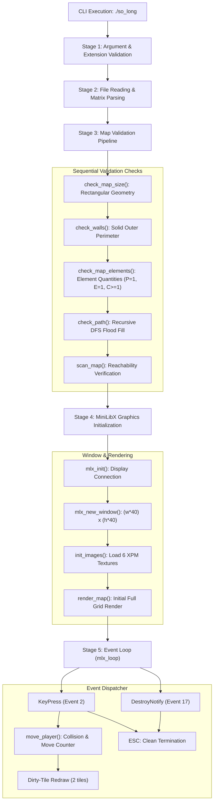
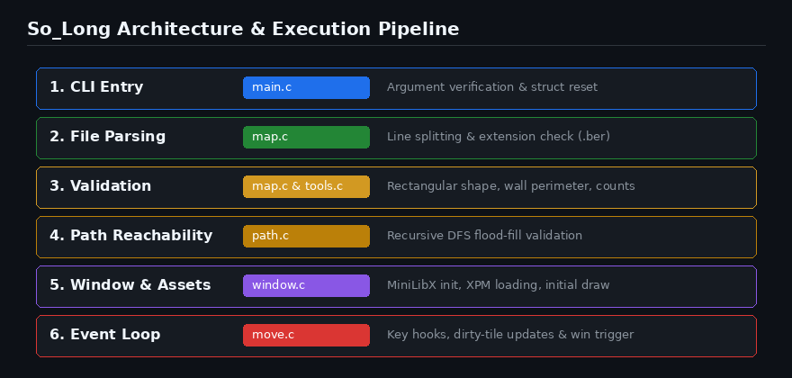

# System Architecture: So_Long

`So_Long` is designed around a procedural, pipeline-based architecture written in C99. The application divides its execution into four strictly separated phases: **Parsing**, **Validation**, **Graphics Initialization**, and the **Event-Driven Game Loop**.

---

## 1. Execution Lifecycle



---

## 2. Core Subsystems

### 2.1 File Parser & Ingestion ([`map.c`](../src/map.c))
- **File Stream Access**: Uses `open(filename, O_RDONLY)` to access the target map.
- **Dynamic Ingestion**: Reads byte-by-byte into a dynamically expanded buffer using `ft_strjoin`.
- **Formatting Validation**: `check_nl()` scans for consecutive newlines (`\n\n`), preventing empty rows within the map definition.
- **Grid Generation**: Invokes `ft_split(sl->map_line, '\n')` to produce the null-terminated 2D array (`char **map`).

### 2.2 Integrity & Path Validation ([`path.c`](../src/path.c), [`map.c`](../src/map.c))
1. **Geometric Rectangularity**: `check_map_size()` verifies that every row length equals `sl->m_w`.
2. **Perimeter Enclosure**: `check_walls()` asserts that row `0`, row `m_h - 1`, column `0`, and column `m_w - 1` are solid walls (`'1'`).
3. **Element Counting**: `check_map_elements()` enforces:
   - Starting Position (`P`): exactly 1.
   - Exit Portal (`E`): exactly 1.
   - Collectibles (`C`): at least 1.
   - Foreign characters: strictly prohibited.
4. **Graph Reachability (Flood Fill)**:
   - `create_tmp_map()` duplicates the grid into `sl->tmp_map`.
   - `check_path(map, y, x)` recursively visits adjacent cells (`Up`, `Down`, `Left`, `Right`), marking visited walkable tiles with `'X'`.
   - Recursion halts at `'1'`, `'E'`, or already visited `'X'`. This ensures that players cannot bypass walls or pass through the exit before collecting keys.
   - `scan_map()` verifies that every `'C'` was reached (`'X'`) and that at least one tile adjacent to `'E'` was reached.

### 2.3 Graphics & Texture Pipeline ([`window.c`](../src/window.c))
- **MiniLibX Subsystem**: Interacts with the display server via `mlx_init()` and creates a native window using `mlx_new_window()`.
- **Texture Loading**: Assets in `images/` are converted to MiniLibX image pointers via `mlx_xpm_file_to_image()`:
  - `floor.xpm` (empty tile `'0'`)
  - `wall.xpm` (wall tile `'1'`)
  - `player.xpm` (player tile `'P'`)
  - `door.xpm` (locked exit `'E'`)
  - `open_door.xpm` (unlocked exit `'E'`)
  - `key.xpm` (collectible `'C'`)
- **Coordinate Mapping**: World tile coordinates `(x, y)` map to window pixel coordinates `(x * 40, y * 40)`.

### 2.4 Event Dispatching & Movement ([`move.c`](../src/move.c))
- **Hook Registration**:
  - `mlx_hook(win, 2, KeyPressMask, key_handle, sl)`: Captures keyboard input.
  - `mlx_hook(win, 17, StructureNotifyMask, kill_window, NULL)`: Captures window close events.
- **Optimized Dirty-Tile Updates**:
  Instead of wiping the window with `mlx_clear_window()` and issuing thousands of draw calls across the whole grid, `move_player()` selectively re-renders only the changed tiles:
  1. The tile the player left: re-rendered as floor (`'0'`).
  2. The tile the player entered: re-rendered as player (`'P'`).
  3. The exit tile: swapped to `open_door.xpm` when `sl->c == 0`.

---

## 3. Data Structure (`t_sl`)

The central game state is encapsulated in `t_sl`, declared in [`so_long.h`](../header/so_long.h):

```c
typedef struct s_sl
{
    void    *mlx;               /* MiniLibX connection identifier */
    void    *win;               /* MiniLibX window pointer */
    void    *floor;             /* Floor texture pointer */
    void    *wall;              /* Wall texture pointer */
    void    *player;            /* Player texture pointer */
    void    *exit;              /* Closed door texture pointer */
    void    *o_exit;            /* Open door texture pointer */
    void    *coin;              /* Collectible key texture pointer */
    char    *map_line;          /* Raw file stream buffer */
    char    **map;              /* Active 2D game grid */
    char    **tmp_map;          /* Cloned grid for flood fill */
    char    *extension;         /* Target file extension (".ber") */
    int     map_file;           /* File descriptor for open() */
    int     p;                  /* Player spawn counter */
    int     px;                 /* Player current X coordinate */
    int     py;                 /* Player current Y coordinate */
    int     e;                  /* Exit portal counter */
    int     ex;                 /* Exit portal X coordinate */
    int     ey;                 /* Exit portal Y coordinate */
    int     c;                  /* Remaining collectible counter */
    int     move_count;         /* Total valid player moves */
    size_t  m_w;                /* Grid width in tiles */
    size_t  m_h;                /* Grid height in tiles */
    size_t  extension_length;   /* Length of ".ber" */
    size_t  filename_length;    /* Length of av[1] */
}   t_sl;
```

---

## 4. Subsystem Interaction Diagram


