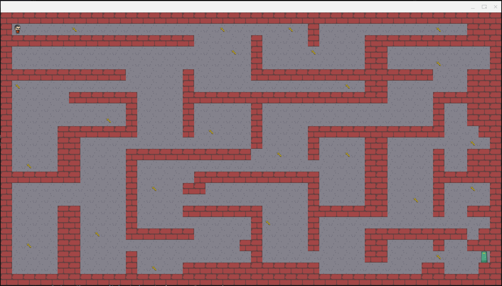
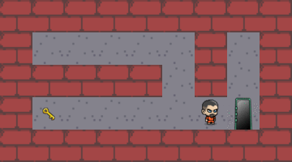

# Game Mechanics: So_Long

`So_Long` is an orthogonal grid-based 2D dungeon crawler. This document details the exact rules, state transitions, collision mechanics, and input handling implemented in the game.

---

## 1. Core Mechanics Overview



### 1.1 Objective
The player's mission is to:
1. Navigate the dungeon from their starting position (`P`).
2. Collect every key collectible (`C`) scattered across the labyrinth.
3. Once all keys are collected, the locked exit door unlocks (`open_door.xpm`).
4. Step onto the open exit (`E`) to escape and win the game.

---

## 2. Grid & Coordinates

- The game world is a 2D discrete coordinate plane where each cell is exactly **40 × 40 pixels**.
- Tile coordinates are expressed as `(x, y)`:
  - `x`: Horizontal column index (`0 <= x < m_w`).
  - `y`: Vertical row index (`0 <= y < m_h`).
- The player coordinate is tracked via `sl->px` and `sl->py`.
- The exit coordinate is tracked via `sl->ex` and `sl->ey`.

---

## 3. Movement & Collision Detection

Movement is managed by `move_player(t_sl *sl, int row, int col)` in [`move.c`](../src/move.c):

```c
target_x = sl->px + row;
target_y = sl->py + col;
```

### 3.1 Collision Rules
1. **Wall Collision (`'1'`)**:
   - Stepping into a wall tile is completely blocked.
   - The move is rejected; the movement counter does not increment.
2. **Exit Collision (`'E'`)**:
   - If keys remain (`sl->c > 0`), the door is locked and impassable. The player cannot step onto the exit.
   - If all keys have been collected (`sl->c == 0`), stepping onto the exit triggers `you_win()`.
3. **Empty Floor (`'0'`)**:
   - Walkable without restriction.
4. **Collectible (`'C'`)**:
   - Walkable; decrements `sl->c` and replaces the tile with empty floor `'0'`.

### 3.2 Directional Vectors

| Key (Linux / macOS) | Movement Vector `(row, col)` | Action |
| :--- | :---: | :--- |
| `W` / `Up Arrow` | `(0, -1)` | Move Up |
| `S` / `Down Arrow` | `(0, +1)` | Move Down |
| `A` / `Left Arrow` | `(-1, 0)` | Move Left |
| `D` / `Right Arrow` | `(+1, 0)` | Move Right |

---

## 4. Collectibles & Dynamic Exit State

The game maintains an active count of remaining collectibles in `sl->c`.

- **Initial State**:
  - The exit tile `(ex, ey)` renders using `door.xpm` (closed wooden door).
  - The door is impassable.
- **Collecting Keys**:
  - When the player moves onto a tile containing `'C'`, `sl->c` is decremented.
  - The tile is overwritten to `'0'`.
- **Exit Opening**:
  - As soon as `sl->c == 0`, the engine immediately updates the exit sprite:
    ```c
    if (!sl->c)
        rendr_all(sl, sl->ex, sl->ey); // Renders images/open_door.xpm
    ```
  - The exit door visually transitions to an open portal, signaling to the player that escape is possible.



---

## 5. Movement Counter

In compliance with the 42 project requirements, every valid move outputs the current movement count to the terminal via `display_moves()`:

```text
0 move
1 move
2 moves
3 moves
...
```

Invalid attempts (such as walking into a wall or trying to step onto a locked exit) do not increment the counter or produce shell output.

---

## 6. End-Game Conditions

### 6.1 Victory (`you_win()`)
- **Trigger**: The player moves onto the exit tile (`sl->map[y][x] == 'E'`) after collecting all coins (`sl->c == 0`).
- **Effect**: 
  - Outputs ANSI green text:
    ```
    \033[1m\033[32mYou Win !!\n
    ```
  - Terminates the process cleanly with exit code `0`.

### 6.2 Game Over / Exit (`game_over()`)
- **Trigger**: The player presses `ESC` or clicks the window close button (`X`).
- **Effect**:
  - Outputs ANSI red text:
    ```
    \033[1m\033[31mGame Over !!\n
    ```
  - Terminates the process cleanly with exit code `0`.

---

## 7. Controls Summary

| Action | Linux X11 Keysyms | macOS Keycodes |
| :--- | :--- | :--- |
| **Move Up** | `W` (119), `Up Arrow` (65362) | `W` (13), `Up Arrow` (126) |
| **Move Down** | `S` (115), `Down Arrow` (65364) | `S` (1), `Down Arrow` (125) |
| **Move Left** | `A` (97), `Left Arrow` (65361) | `A` (0), `Left Arrow` (123) |
| **Move Right** | `D` (100), `Right Arrow` (65363) | `D` (2), `Right Arrow` (124) |
| **Quit Game** | `ESC` (65307), Close Button | `ESC` (53), Close Button |
