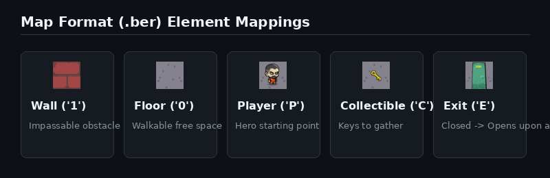

# Map Format Specification (.ber): So_Long

Maps in `So_Long` are defined in plain text files ending with the `.ber` extension. The game parses and validates these files before creating the window.

---

## 1. Map Characters & Tile Mapping

| Character | Entity | Description | Rules |
| :---: | :--- | :--- | :--- |
| **`1`** | Wall | Impassable barrier | Must enclose the entire perimeter of the map. |
| **`0`** | Floor | Walkable empty space | Traversed freely by the player. |
| **`P`** | Player Spawn | Starting position | **Exactly 1** must be present on the map. |
| **`C`** | Collectible | Key required to unlock exit | **At least 1** must be present on the map. |
| **`E`** | Exit Portal | Escape gateway | **Exactly 1** must be present on the map. |



---

## 2. Validation Constraints

Every map must satisfy the following criteria:

### 2.1 File Extension
The filename passed to `./so_long` must end with `.ber`. If not, `check_extention()` terminates with:
```
Failed to open the map file.
```

### 2.2 Formatting & Empty Lines
The map file must not contain consecutive newlines (`\n\n`) or trailing blank lines. If detected, `check_nl()` terminates with:
```
Invalid map: line error
```

### 2.3 Strict Rectangularity
Every row in the map matrix must have identical character length (`m_w`). Maps with irregular row lengths are rejected by `check_map_size()`:
```
Invalid map: map size error
```

### 2.4 Wall Perimeter Enclosure
The map must be completely enclosed by walls:
- Row `0` (top border) must contain only `'1'`.
- Row `m_h - 1` (bottom border) must contain only `'1'`.
- Column `0` (left border) of every row must be `'1'`.
- Column `m_w - 1` (right border) of every row must be `'1'`.

If any border tile is not `'1'`, `check_walls()` terminates with:
```
Invalid map: walls error
```

### 2.5 Element Counts
Enforced by `check_map_elements()`:
- `sl->p == 1` (No duplicate players, no missing player).
- `sl->e == 1` (No duplicate exits, no missing exit).
- `sl->c >= 1` (At least one key collectible must exist).
- Only characters `0`, `1`, `P`, `C`, `E` are permitted.

Violation output:
```
Invalid map: elements error
```

### 2.6 Path Reachability (Flood Fill)
Enforced by `check_path()` and `scan_map()` in [`path.c`](../path.c):
1. **Collectible Reachability**: The player must be able to reach every single `'C'` on the map without stepping on the exit `'E'` (since the exit is impassable prior to collecting all keys).
2. **Exit Reachability**: The exit `'E'` must have at least one reachable orthogonal neighbor (`Up`, `Down`, `Left`, `Right`).

If any key cannot be reached, or if the exit is walled off:
```
Cannot find a valid path
```

---

## 3. Map Examples

### 3.1 Valid Map (Minimal: 9 × 5)
```text
111111111
1P0000101
111110101
1C0000CE1
111111111
```
- Dimensions: 9 wide, 5 high.
- Walls: Fully enclosed.
- Elements: 1 `P`, 1 `E`, 2 `C`.
- Solvable path: `P` traverses right, down, and around the dividing wall to collect both `C`s and reach `E`.

### 3.2 Valid Map (Medium Chamber: 19 × 9)
```text
1111111111111111111
1P00100000100000001
1010101110101111101
1010001C10001C00101
1011111011101010101
1000C01000101010001
1111011010101011101
1C000000100000000E1
1111111111111111111
```

---

## 4. Invalid Map Examples & Diagnostics

### Case A: Non-Rectangular
```text
1111111111
1P00000001
1000C0001    <-- Length 9 instead of 10
10000000E1
1111111111
```
**Diagnostic**: `Invalid map: map size error`

### Case B: Missing Wall Perimeter
```text
1111011111   <-- Gap in top border
1P000000C1
10000000E1
1111111111
```
**Diagnostic**: `Invalid map: walls error`

### Case C: Duplicate Elements
```text
1111111111
1P000000P1   <-- Two player spawns
1000C000E1
1111111111
```
**Diagnostic**: `Invalid map: elements error`

### Case D: Collectible Trapped Behind Exit
```text
1111111
1P00E0C1     <-- Coin is isolated behind the locked exit!
1111111
```
**Diagnostic**: `Cannot find a valid path`  
*(Because the player cannot step onto `E` until all coins are collected, the coin at column 5 cannot be reached without walking through `E`)*.
